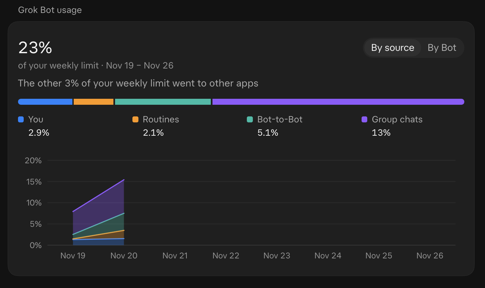

# How to optimize your Grok Bot usage with webhooks

**TLDR:** Use a webhook routine when something outside can tell your bot that new data arrived. Keep a timed routine when the clock is the reason the job runs. And check your usage breakdown first, because your chats might be costing more than your routines.

I run a team of Grok Bots, and a lot of their work runs on routines. Like many others, I immediately started running into usage limits early in the week! At first, I simply cut back most of my routines. But recently, Matt Palmer (@mattyp) and Lauren Tan (@poteto) brought up webhooks in their [live Grok Bot Q&A](https://x.com/mattyp/status/2121439659179848108). So I dug in. Here's what I learned, in plain terms, and how to decide which jobs should use a webhook.

## Timed routines and webhooks

Every routine needs something to start it. A routine that runs on a timer is like walking to the mailbox every day to check for a specific package. Most days it's empty, but the trip still costs you time and energy. A routine that runs on a webhook is like a doorbell. Your bot stays put and only wakes up when something actually arrives.

## First, check where your usage goes

Here are my own numbers for this week so far (Nov 19 to Nov 20). I've used 23% of my weekly Grok Bot limit. Routines took only 2.1% of the limit. Group chats took 13%, my bots messaging each other took 5.1%, and my own chats with my bots took 2.9%.

Your split will look different, so check yours first. Switching timed routines to webhooks can only shrink the routine slice. If your bots chat a lot, that's probably where most of your usage goes.

## Why webhooks save usage

Grok Bot measures usage by the steps a bot takes and the text it reads and writes (tokens). It doesn't count how many messages you send, so a routine that doesn't run spends nothing.

A timed routine runs on the clock, even when nothing new came in. A webhook routine only runs when something outside Grok Bot sends it a request.

So who sends that request? It can be a small script you set up outside Grok Bot. It checks for external changes and contacts your bot only when something is new, passing along only the new items. Google Apps Script, GitHub Actions or a Cloudflare Worker can all run a script like this, and each has a free tier.

You might be thinking that script still checks on a timer, right? Well, it does, but its checks don't use any of your Grok Bot usage! Your bot only wakes up when there's real news, and it has less to read when it does.

## How to decide between a timed routine and a webhook

Ask one question: can the thing I'm waiting on tell my bot when something happens?

**If yes, use a webhook routine or one of Grok Bot's built-in triggers.** Event triggers are great for things like:

- GitHub events, like a pull request opening or tests passing or failing. Grok Bot has a built-in trigger for these, so you don't even need a webhook.
- Slack messages. Also a built-in trigger.
- An email arriving. Your bot has its own email address, and you can add a tag to it, like name+alerts@. That's called plus addressing. Mail sent to a tagged address starts only the routine it belongs to, so you can have Gmail forward just the emails that matter.
- Any app or script that can send a web request. Each webhook routine comes with its own web address and a secret key, both shown in the routine's settings. The sender has to include that key with every request.

**If the job is really about time, keep it a timed routine.** Timed routines are great for things like:

- A morning digest or a weekly report. Nothing outside is going to announce "it's Monday."
- A reminder or deadline that has to happen even if nothing ever shows up.

## Two updates I'm making now

These are in progress, so there are no before-and-after numbers here yet.

1. **Night-before meeting prep.** This was a timed routine that ran every night, even when tomorrow's calendar was empty. Now I'm switching it so a small calendar script outside Grok Bot wakes the bot only when tomorrow has a matching meeting scheduled.
2. **Daily Grok Bot changelog scan.** The Grok Bot team is shipping like crazy these days, with a ton of improvements every day. My original scan was a timed routine that checked 7 times a week. Now I'm switching it so a script watches the Grok Bot changelog page and sends the new entry when one shows up.

Next up is a daily finance check. Instead of running on a timer, it'll wake up when my bank sends an alert email.

## Things to be mindful of

- **Guard each webhook routine's secret key.** Every request has to include the routine's secret key (also called a bearer token) in the request's Authorization header. Grok Bot doesn't check anything else, so your bot can't confirm who actually sent a request. If the key leaks, anyone can wake your bot and feed it whatever instructions they want. Treat it like a password, keep it out of chats, and never post it.
- **Every request uses usage.** Grok Bot doesn't filter requests for you, so each one starts a run that counts. Do your filtering in your outside script.
- **Paused means lost.** A request sent to a paused routine is lost unless the sender tries again. And if a run fails, Grok Bot won't retry it.
- **There are limits.** Grok Bot allows up to 300 runs an hour across all your routines, and 200 an hour for any one routine.
- **Some services need a go-between.** Stripe, App Store Connect, and the push notifications from Gmail and Google Calendar can't add that key. They need a small relay in between, which receives their message and passes it on with your key. Hookdeck is one example, or you can write a short Cloudflare Worker.
- **Some services charge extra.** Zapier's free plan treats webhooks as a premium feature, and IFTTT webhooks need a paid plan, so check current pricing before you build on them.

lmk if you try this and what it saves you!

## Sources

- [Grok Bot Q&A with Matt Palmer and Lauren Tan, Nov 13](https://x.com/mattyp/status/2121439659179848108), where the webhooks idea came from
- [Grok Bot docs: skills, routines and automations](https://docs.x.ai/grok-bot/skills-routines-and-automations) for the run limits, the bearer key and no retries on failed runs
- [Grok Bot FAQ](https://docs.x.ai/grok-bot/faq) for usage being measured by steps and tokens
- [Hookdeck's Grok Bot webhook guide](https://hookdeck.com/webhooks/platforms/using-hookdeck-with-grok-bot-reliable-webhook-triggers) for the key being the only check and requests to paused routines being lost
- [Zapier free plan](https://help.zapier.com/hc/en-us/articles/32337438839565-What-s-included-in-Zapier-s-Free-plan) and [IFTTT help](https://help.ifttt.com/hc/en-us/articles/1260803229749-IFTTT-Service-Rate) for the webhook pricing
